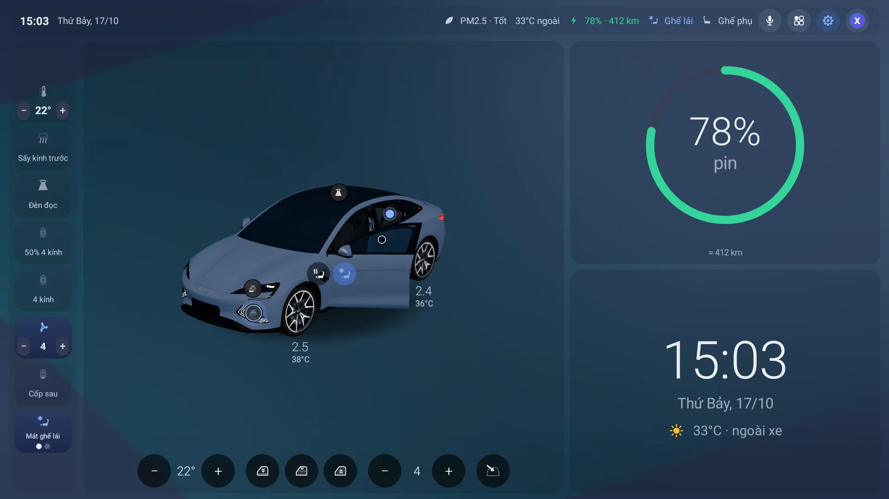
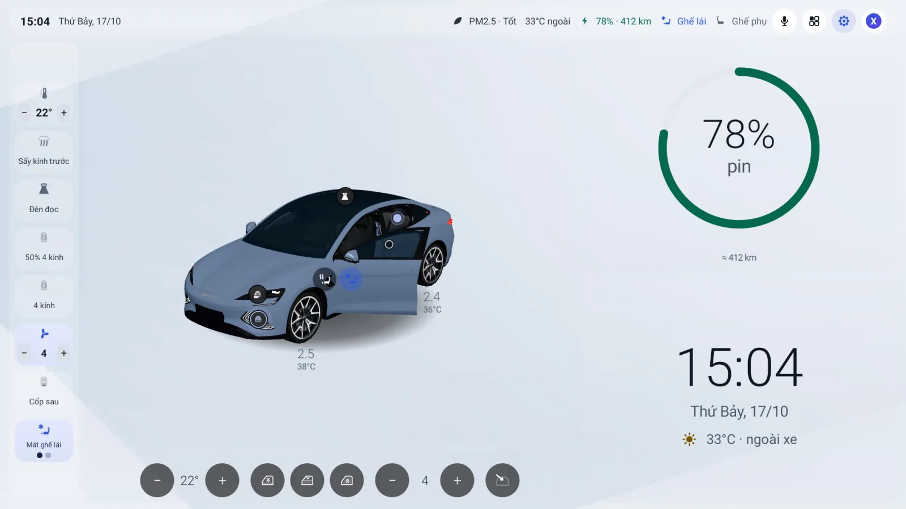
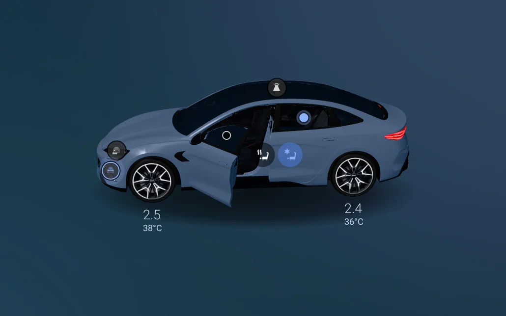
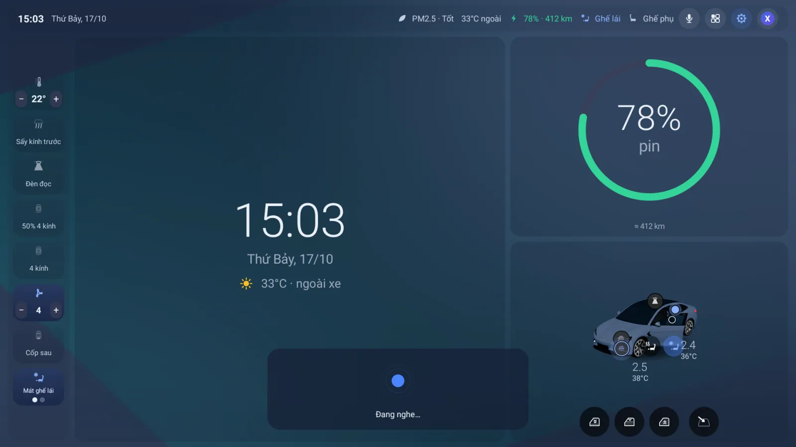
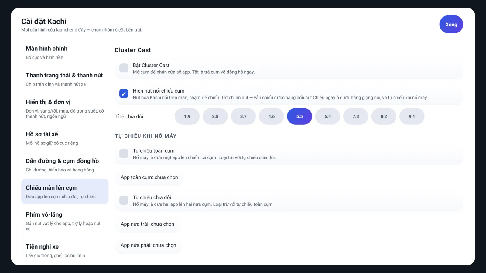
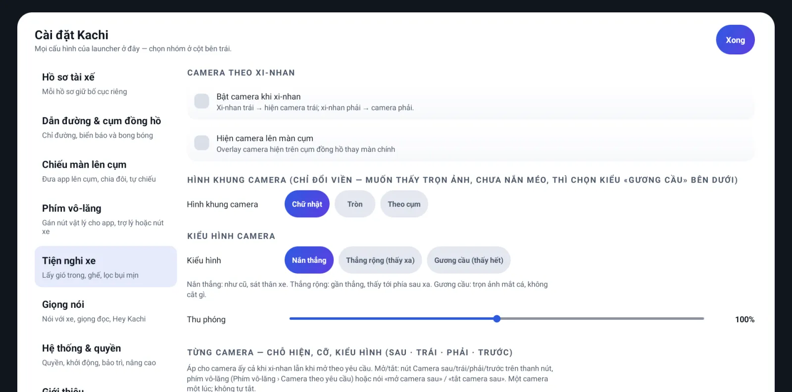
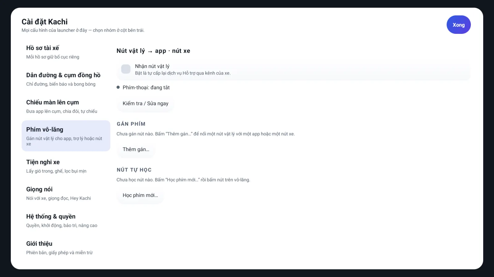

# Kachi launcher

**(VI)** Kachi là màn hình chính (launcher) cho đầu xe **BYD DiLink**, do cộng đồng làm. Chạy app thật trong từng ô, hiện xe 3D theo trạng thái thật của xe, chiếu bản đồ lên cụm đồng hồ, nghe lệnh tiếng Việt ngay trên đầu xe, gán phím vô-lăng, mở camera — và tự cập nhật qua mạng.

**(EN)** Kachi is a community-built home screen (launcher) for **BYD DiLink** head units. It runs real apps inside home-screen slots, shows a 3D car that follows the car's real state, casts maps to the instrument cluster, understands Vietnamese voice commands on the head unit itself, remaps steering-wheel keys, opens the cameras — and updates itself over the air.

> [!IMPORTANT]
> **(VI)** Dự án cá nhân, **không chính thức**, không liên kết với BYD. Không cam kết an toàn lái xe, tương thích hay độ ổn định — cài và dùng với rủi ro của riêng bạn. Đừng thao tác màn hình khi xe đang chạy.
>
> **(EN)** A personal project, **not official**, not affiliated with BYD. No driving-safety, compatibility or stability claim — install and use it at your own risk. Don't operate the screen while the car is moving.

## Phiên bản · Version

| | |
|---|---|
| Phiên bản · Version | **3.1.13** (versionCode **218**) |
| Tệp · File | [`apk/Kachi-3.1.13-release.apk`](apk/Kachi-3.1.13-release.apk) |
| Kích thước · Size | 56 252 105 B |
| SHA-256 | `a89ab3c094a2ea2a1a71fe5067d0456285178b72fb0c29cdf49df006887986f3` |
| Gói · Package | `com.byd.launcher` |
| Trang giới thiệu · Intro page | [`docs/index.html`](docs/index.html) (GitHub Pages) |

## Cài đặt và cập nhật · Install and update

**(VI)**

1. **Tải** `apk/Kachi-3.1.13-release.apk` trên nhánh `main` (nút **Raw** / Download trên GitHub). Kiểm SHA-256 ở bảng trên nếu muốn.
2. **Cài bằng adb**: `adb install -r Kachi-3.1.13-release.apk`. Chép vào xe rồi chạm để cài có thể bị ROM DiLink chặn (Kachi là launcher) — cài bằng adb thì qua.
3. Mở Kachi, bấm **Cho phép gỡ lỗi USB** khi được hỏi (một lần). Kachi dùng kênh này để tự cấp quyền, đưa app vào ô, chiếu cụm và cài cập nhật — không cần root, không sửa firmware.
4. *Cài đặt › Hệ thống & quyền › Màn hình chính › **Đặt Kachi làm màn hình chính***.
5. Xem *Cài đặt › Giới thiệu*: phải ra **Phiên bản 3.1.13 (mã 218)**.

**Cập nhật về sau (OTA)**: *Cài đặt › Hệ thống & quyền › **Kiểm tra cập nhật*** — Kachi tìm tệp `apk/Kachi-<phiên bản>-release.apk` mới hơn trên `main`, hỏi trước rồi cài đè. Hồ sơ và cấu hình giữ nguyên, không cần máy tính. Bật *Tự động cập nhật* thì mỗi lần mở Kachi sẽ tự dò; có bản mới thì nút ⚙ có **chấm đỏ nhỏ**. Cập nhật không lùi bản được. Bản cài trước 1.41 (khoá ký cũ) phải gỡ rồi cài tay một lần. Chi tiết kênh: [`apk/README.md`](apk/README.md).

**(EN)**

1. **Download** `apk/Kachi-3.1.13-release.apk` from the `main` branch (GitHub **Raw** / Download). Check the SHA-256 above if you like.
2. **Install with adb**: `adb install -r Kachi-3.1.13-release.apk`. Copying it to the car and tapping it may be blocked by the DiLink ROM (Kachi is a launcher); adb works.
3. Open Kachi and tap **Allow USB debugging** when asked (once). Kachi uses that channel to grant its own permissions, put apps into slots, cast to the cluster and install updates — no root, no modified firmware.
4. *Settings › System & permissions › Home screen › **Set Kachi as the home screen***.
5. Check *Settings › About*: it should read **Version 3.1.13 (build 218)**.

**Later updates (OTA)**: *Settings › System & permissions › **Check for updates*** — Kachi looks for a newer `apk/Kachi-<version>-release.apk` on `main`, asks first, then installs it over the top. Profiles and settings are kept; no computer needed. With *Auto update* on, Kachi checks each time it opens, and a **small red dot** on the ⚙ button means an update is waiting. Updates cannot be rolled back. Builds installed before 1.41 (old signing key) must be uninstalled and installed by hand once. Channel details: [`apk/README.md`](apk/README.md).

## Ảnh chụp · Screenshots

| | |
|---|---|
|  |  |
| Màn hình chính nền sáng · Light home | Xe 3D: vuốt để xoay · 3D car: swipe to rotate |
|  |  |
| Kachi đang nghe lệnh · Kachi listening | Chiếu màn lên cụm · Cluster cast |
|  |  |
| Camera theo xi-nhan và theo yêu cầu · Cameras | Cài đặt › Phím vô-lăng · Settings › Steering-wheel keys |

Ảnh chụp trên máy ảo Android 10 (1920×1080) với số liệu xe giả lập; trên xe thật các ô hiện số đọc từ xe. · Taken on an Android 10 emulator (1920×1080) with simulated car data; on a real car the tiles show what the car reports.

## Tính năng · Features

**(VI)** Mọi tính năng nằm trong một app, cấu hình ở *Cài đặt* của Kachi (11 nhóm ở cột trái). Hầu hết lưu theo hồ sơ tài xế. Ký hiệu **🚗** = đã làm xong nhưng **chưa đo trên xe thật**. Trạng thái từng chức năng: [danh mục chức năng](docs/kachi-feature-catalog.html).

### Màn hình chính và xe 3D

- **Ô làm việc**: 5 bố cục sẵn (1 ô · 2 cột · 2 hàng · 3 ô · 4 ô) hoặc tự vẽ trên lưới 12 × 6. Mỗi ô là **một app chạy thật** (màn ảo), một widget Kachi (xe 3D, năng lượng, đồng hồ, nhạc, lối tắt app, trình chiếu ảnh…) hoặc widget Android của app khác.
- **Widget xe 3D**: kính, cửa, cốp, đèn, ghế hiện **theo trạng thái thật** của xe. Phần bấm được có **chấm** — chạm chấm là điều khiển (chạm đúp chấm kính = mở hết); **vuốt để xoay** quanh xe. Mô hình đọc từ chính xe (app camera 360 của BYD); xe nào không vẽ được 3D thì khung ghi *"3D không khả dụng trên xe này"*, không tự lùi về hình 2D. Chọn màu xe, ảnh nền sau xe, áp suất/nhiệt độ lốp trong phần *Hình xe* của Cài đặt. 🚗 (mới, chờ anh em xác nhận trên nhiều xe)
- **Bung to ô**: nút ở đầu mỗi ô bung một khung ra trọn màn chính; chạm lại là về như cũ.
- **Thanh trạng thái và thanh nút xe** tuỳ chỉnh (chip, nhãn, thứ tự, viền đặt thanh nút); hình nền, sáng/tối; chữ và icon tự đổi màu theo ảnh nền.
- App tự bật ra khỏi ô (hay gặp với Waze) được **kéo về lại đúng ô** (bật sẵn, tắt được trong Cài đặt).
- Giao diện Tiếng Việt, English, 中文, ไทย, Bahasa Melayu hoặc theo ngôn ngữ của xe.

### Điều khiển xe: nút, phím, giọng nói

- **Một bộ nút duy nhất** dùng chung cho thanh nút xe, widget, phím vô-lăng và giọng nói: kính 4 cửa (cả mức 50 %), cốp, cửa sổ trời, đèn, điều hoà (nhiệt độ, gió, AUTO), sấy kính, lọc bụi mịn, ghế sưởi/mát. Nút nào chạy được tuỳ đời xe — tra danh mục chức năng.
- **Cốp đọc trạng thái thật**; mở cốp khi xe đang chạy luôn bị chặn.
- **Phím vật lý và vô-lăng**: học mã phím rồi gán cho một app, trợ lý của xe, *Kachi nghe*, bất kỳ nút xe nào hoặc một camera; gán riêng núm bệ giữa và phím vô-lăng. Kachi tự kiểm và tự nối lại phím sau mỗi lần tắt/mở xe.
- **Tự động**: nổ máy thì tự lấy gió trong; ghế sưởi/mát tự chỉnh theo nhiệt độ và được bật lại khi firmware tự tắt; tự lọc bụi mịn; mưa thì tự bật sấy kính 🚗.

### Chiếu cụm đồng hồ và HUD

- **Chiếu màn lên cụm**: đưa app (bản đồ, CarPlay, Android Auto…) lên màn cụm sau vô-lăng, toàn màn hoặc chia đôi chỉnh được tỉ lệ; tự chiếu khi nổ máy; bóng nổi đổi app trong một chạm; nút *Cứu hộ cụm*. Hai kiểu cụm Bo tròn / Chữ nhật; khung, DPI lưu theo hồ sơ.
- **Dẫn đường lên cụm**: Kachi đọc hướng rẽ từ Google Maps (cả khi app ở nền), VietMap và Waze (khi app đang hiện) rồi ghi xuống cụm: mũi tên, khoảng cách, tên đường, giờ đến. Biển tốc độ và cảnh báo camera tự vẽ, chỉnh được cỡ và vị trí.
- **Tên bài trên cụm khi đang chiếu** *(tuỳ chọn, mặc định tắt)* 🚗.
- **HUD kính lái**:
  - **Seal: không hỗ trợ dẫn đường trên HUD.** Đã đo trên xe: gói dữ liệu tới xe nhưng HUD zin không hiện, bằng cả hai cách; việc này ngoài tầm app.
  - **Sealion 6**: đang thử nhiều cách gửi tên đường lên HUD (*Cài đặt › Dẫn đường & cụm đồng hồ*) 🚗.

### Giọng nói và Hey Kachi

- **Nghe tại máy**: sherpa-onnx + mô hình tiếng Việt `zipformer-vi` (~74 MB, tải một lần trong app hoặc chép qua USB). **Tiếng nói không gửi ra mạng.**
- **Lối gọi**: nút mic trên thanh trạng thái, phím vô-lăng, hoặc nói **"Hey Kachi"** (mặc định tắt; nhẹ CPU, bắt được câu gọi nói nhỏ).
- **Lệnh**: điều khiển xe, đọc thông tin xe, mở/đóng app (cả *"vào ô số 2"*), nhạc và YouTube (*"nhạc Sơn Tùng trên YouTube"*), dẫn đường (cả nhiều app một câu), đổi hồ sơ, đổi bố cục; ghép hai việc bằng *"và"* / *"rồi"* / *"xong"*.
- Lúc Kachi nghe, nhạc tự **hạ nhỏ** rồi trả mức cũ. Phản hồi đọc bằng giọng offline; tự dạy Kachi tên app khó đọc. Hiện chỉ nghe tiếng Việt.

### Camera

- **Theo xi-nhan** (đã đo trên Seal và Sealion 6): bật xi-nhan trái/phải là camera bên đó nổi lên, tắt theo đèn.
- **Theo yêu cầu**: mở camera sau · trái · phải · trước bằng nút, phím hoặc giọng nói; bấm lại để tắt.
- Ba kiểu hình (*Nắn thẳng* · *Thẳng rộng* · *Gương cầu*), thu phóng 50–150 %, từng camera chỉnh riêng; hiện trên màn chính hoặc lên cụm.

### Hồ sơ tài xế

- Mỗi hồ sơ giữ riêng bố cục, nội dung ô, thanh trên, thanh nút, hình nền, giao diện, đơn vị, ngôn ngữ, sổ địa chỉ, kiểu camera và phần chiếu cụm.
- Đổi nhanh bằng chip trên thanh trên hoặc nói *"chuyển sang hồ sơ …"*; đổi hồ sơ **không tắt app** đang chạy.
- Xuất / nhập tệp `.kachi`; bản *để chia sẻ* bỏ địa chỉ và lịch dẫn đường.

### Cập nhật qua mạng (OTA)

- *Kiểm tra cập nhật* + *Tự động cập nhật* trong *Cài đặt › Hệ thống & quyền*; tải từ `apk/` trên `main`, hỏi trước rồi cài đè, giữ nguyên dữ liệu. Xem mục **Cài đặt và cập nhật** ở trên.

**(EN)** Everything lives in one app and is configured in Kachi's *Settings* (11 groups in the left rail). Most settings are saved per driver profile. **🚗** = built but **not yet measured on a real car**. Per-feature status: the [feature catalogue](docs/kachi-feature-catalog.html).

### Home screen and 3D car

- **Slots**: 5 preset layouts (1 slot · 2 columns · 2 rows · 3 slots · 4 slots) or your own on a 12 × 6 grid. Each slot holds **a real running app** (virtual display), a Kachi widget (3D car, energy, clock, media, app shortcuts, photo slideshow…) or another app's Android widget.
- **3D car widget**: windows, doors, trunk, lamps and seats follow **the car's real state**. Controllable parts carry a **dot** — tap the dot to operate it (double-tap a window dot = fully open); **swipe to rotate** around the car. The model is read from the car itself (BYD's 360-camera app); if a car can't draw it, the frame says *"3D not available on this car"* and never falls back to 2D. Paint colour, a backdrop image and tyre pressure/temperature are set in the *Car image* part of Settings. 🚗 (new, waiting for confirmation on more cars)
- **Expand a slot**: a button at the top of each slot expands that frame to the whole home area; tap again to restore.
- **Status bar and car button bar** are customisable (chips, labels, order, which edge the button bar sits on); wallpaper, light/dark; text and icons adapt their colour to the wallpaper.
- An app that pops out of its slot (common with Waze) is **pulled back into the same slot** (on by default, can be switched off).
- UI in Vietnamese, English, 中文, ไทย, Bahasa Melayu, or follow the car's language.

### Car controls: buttons, keys, voice

- **One control registry** shared by the button bar, widgets, steering-wheel keys and voice: all four windows (including 50 %), trunk, sunroof, lamps, climate (temperature, fan, AUTO), defrost, PM2.5 filter, seat heating/cooling. What works depends on the car generation — see the feature catalogue.
- **The trunk reads its real state**; opening it while the car is moving is always blocked.
- **Physical and steering-wheel keys**: learn a key, then bind it to an app, the car's assistant, *Kachi listens*, any car control or a camera; the centre-console knob and the wheel keys can be bound separately. Kachi checks and re-attaches the keys after every power cycle.
- **Automation**: recirculation on engine start; seat heating/cooling by temperature, turned back on when the firmware switches it off; PM2.5 auto-filter; auto-defrost when it rains 🚗.

### Cluster casting and HUD

- **Cast to the cluster**: put an app (maps, CarPlay, Android Auto…) on the cluster behind the wheel, full screen or split with an adjustable ratio; autostart on engine start; the floating bubble switches apps in one tap; a *Cluster rescue* button. Rounded / Rectangle cluster styles; frame and DPI saved per profile.
- **Navigation on the cluster**: Kachi reads turn instructions from Google Maps (even in the background), VietMap and Waze (while on screen) and writes them to the cluster: arrow, distance, street name, arrival time. Its own speed sign and camera alerts, with adjustable size and position.
- **Now-playing title on the cluster while casting** *(optional, off by default)* 🚗.
- **Windshield HUD**:
  - **Seal: navigation on the HUD is not supported.** Measured on the car: the data reaches the car but the stock HUD shows nothing, by either method; this is outside what an app can do.
  - **Sealion 6**: several ways of sending the street name to the HUD are under test (*Settings › Navigation & cluster*) 🚗.

### Voice and Hey Kachi

- **On-device recognition**: sherpa-onnx with the Vietnamese `zipformer-vi` model (~74 MB, downloaded once in the app or copied over USB). **Speech never leaves the car.**
- **Ways in**: the mic button in the status bar, a steering-wheel key, or saying **"Hey Kachi"** (off by default; light on CPU, catches quietly spoken wake phrases).
- **Commands**: car controls, read vehicle data, open/close apps (including *"into slot 2"*), music and YouTube, navigation (several apps in one sentence), switch profile, switch layout; chain two actions with *"và"* / *"rồi"* / *"xong"*.
- Music is **ducked** while Kachi listens, then restored. Replies use an offline voice; you can teach Kachi hard-to-pronounce app names. Vietnamese only for now.

### Cameras

- **On turn signal** (measured on Seal and Sealion 6): the left/right camera pops up with the signal and closes with the lamp.
- **On demand**: open the rear · left · right · front camera with a button, a key or your voice; press again to close.
- Three projections (*Straightened* · *Wide straight* · *Convex mirror*), zoom 50–150 %, per-camera settings; on the main screen or on the cluster.

### Driver profiles

- Each profile keeps its own layout, slot contents, top bar, button bar, wallpaper, theme, units, language, address book, camera style and cluster-casting setup.
- Switch from the chip in the top bar or by saying *"chuyển sang hồ sơ …"*; switching **does not close** running apps.
- Export / import `.kachi` files; the *for sharing* export leaves out addresses and the navigation schedule.

### Over-the-air updates (OTA)

- *Check for updates* + *Auto update* in *Settings › System & permissions*; downloads from `apk/` on `main`, asks first, installs over the top and keeps your data. See **Install and update** above.

## Giới hạn đã biết · Known limits

**(VI)**
- HUD Seal không hiện dẫn đường (xem trên). Ô biển giới hạn tốc độ gốc của cụm/HUD không nhận số từ app — Kachi vẽ biển của riêng mình.
- Tắt chiếu cụm xong, giữa cụm có thể còn mảng đen tới lần chiếu sau hoặc khởi động lại.
- Ngay sau khi cập nhật, YouTube trong ô có thể phải bấm phát một lần.
- App tự mở màn thứ hai (Waze) có lúc không nằm yên trong ô; app có DRM (Netflix) không bao giờ vào ô được.
- Firmware BYD tắt app mỗi lần tắt máy, nên lúc nổ máy Kachi cần vài giây để nối lại kênh, phím và ô.

**(EN)**
- No navigation on the Seal HUD (see above). The cluster/HUD's stock speed-limit sign doesn't accept values from an app — Kachi draws its own.
- After cluster casting stops, a black patch may stay in the middle of the cluster until the next cast or a restart.
- Right after an update, YouTube in a slot may need one tap on play.
- Apps that open a second display (Waze) don't always stay in their slot; DRM apps (Netflix) can never run in a slot.
- BYD firmware kills apps on every engine-off, so Kachi needs a few seconds after start-up to reconnect its channel, keys and slots.

## Gặp lỗi · Reporting problems

**(VI)** Chép thư mục `Android/data/com.byd.launcher/files/kachi-logs/` (ra USB chẳng hạn), chụp *Cài đặt › Giới thiệu* (đừng đoán bản đang chạy), mô tả lỗi kèm ảnh chụp màn hình rồi gửi qua [GitHub Issues](https://github.com/dangkhoi/byd-kachi/issues).

**(EN)** Copy the `Android/data/com.byd.launcher/files/kachi-logs/` folder (to a USB stick, say), take a screenshot of *Settings › About* (don't guess the version), describe the problem with screenshots and send it via [GitHub Issues](https://github.com/dangkhoi/byd-kachi/issues).

## Tài liệu · Documentation

- [Mục lục tài liệu · Docs index](docs/README.md) — bản đồ mọi tài liệu hiện hành · the map of every current document.
- [Hướng dẫn dùng Kachi · User guide](docs/HUONG-DAN-KACHI.md) — cài/OTA, màn hình chính, hồ sơ, từng nhóm Cài đặt, bảng lệnh giọng nói, FAQ (VI + EN).
- [Hướng dẫn có hình · Illustrated guide](docs/guide/HUONG-DAN-CO-HINH.html).
- [Danh mục chức năng · Feature catalogue](docs/kachi-feature-catalog.html) — mọi chức năng kèm trạng thái trên xe.
- [Việc đang làm · Backlog](docs/PROJECT-BACKLOG.md).

Lịch sử từng phiên bản nằm trong git và các tài liệu trong `docs/`. · Per-version history lives in git and in `docs/`.

## Build từ nguồn · Building from source

**(VI)** JDK 17, Android SDK compileSdk/targetSdk 37, minSdk 29. Bản phát hành: `./gradlew :app:assembleRelease` (cần khoá ký riêng qua `keystore.properties`, không có trong repo). Test: `./gradlew :app:testDebugUnitTest :core:test :car-integration:test :vehicle-contracts:test :offcar-planner:test`. Bản dựng từ một bản clone sạch không có ảnh nền đóng gói và mô hình xe 3D — app đọc mô hình từ chính xe lúc chạy.

**(EN)** JDK 17, Android SDK compileSdk/targetSdk 37, minSdk 29. Release build: `./gradlew :app:assembleRelease` (needs the project's own signing key via `keystore.properties`, not in the repo). Tests: `./gradlew :app:testDebugUnitTest :core:test :car-integration:test :vehicle-contracts:test :offcar-planner:test`. A build from a clean clone has no bundled wallpapers or 3D car model — the app reads the model from the car at run time.

**Ranh giới an toàn · Safety boundaries**: không giả lập GPS, quyền vị trí chỉ để đọc · no mock location, location permission is read-only; Kachi chỉ tắt lại cái nó tự bật · Kachi only turns off what it turned on; bản phát hành không có bề mặt kiểm thử nào được export · the release APK exports no test surface.

## Ghi công · Credits

**(VI)** Xem [CREDITS.md](CREDITS.md). Kachi dùng [dadb](https://github.com/mobile-dev-inc/dadb) (Apache-2.0), [sherpa-onnx](https://github.com/k2-fsa/sherpa-onnx) (Apache-2.0) cùng ONNX Runtime (MIT), và [Filament](https://github.com/google/filament) (Apache-2.0) để vẽ xe 3D. Kachi khởi đầu là một nhánh của ClusterNav, dự án chiếu dẫn đường lên cụm đồng hồ của cùng tác giả **dangkhoi**.

**(EN)** See [CREDITS.md](CREDITS.md). Kachi uses [dadb](https://github.com/mobile-dev-inc/dadb) (Apache-2.0), [sherpa-onnx](https://github.com/k2-fsa/sherpa-onnx) (Apache-2.0) with ONNX Runtime (MIT), and [Filament](https://github.com/google/filament) (Apache-2.0) to render the 3D car. Kachi started as a fork of ClusterNav, the same author's (**dangkhoi**) cluster-navigation project.

BYD và tên xe là nhãn hiệu của chủ sở hữu tương ứng. Mô hình xe 3D trong ảnh chụp là mô hình của BYD, đọc từ phần mềm của xe. · BYD and the car names are trademarks of their respective owners. The 3D car in the screenshots is BYD's own model, read from the car's software.

## Giấy phép · License

[MIT](LICENSE).
